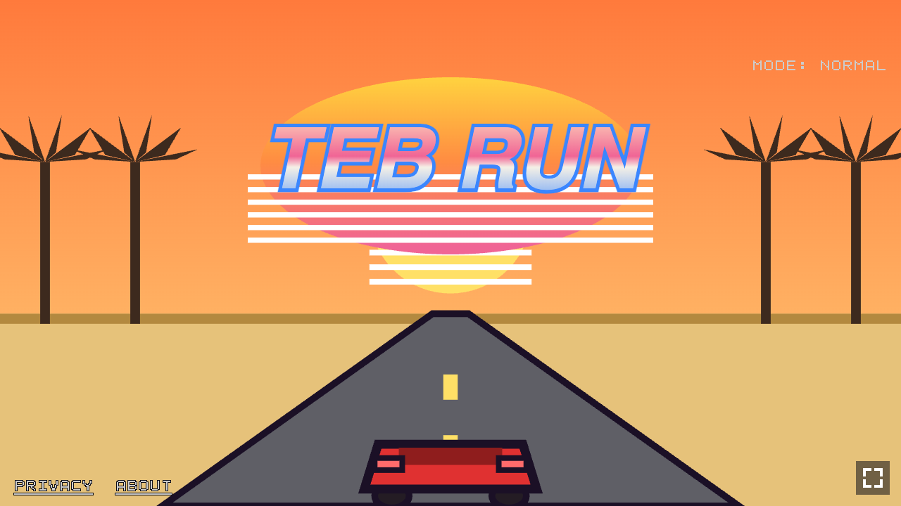
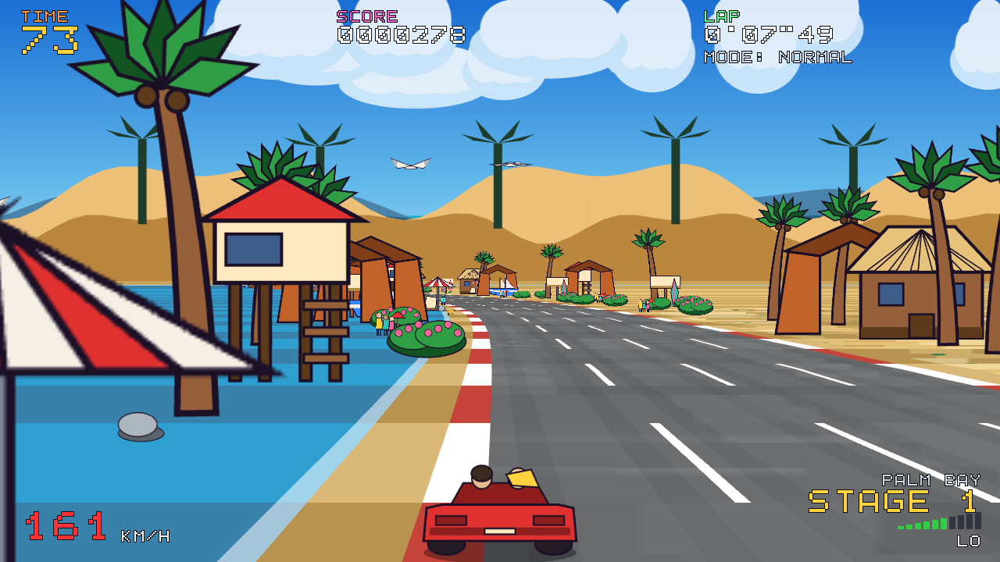

# TEB RUN

**A free 80s sunset-coast arcade racer that runs in a browser tab.** Sprite-scaling
pseudo-3D road, a checkpoint timer, and at the end of every stage the road
**physically splits in two**: the side you steer into is your next stage.
15 stages across 5 levels, 5 endings, a car radio with three original songs
synthesized in code.

TypeScript + Vite + Canvas 2D + Web Audio. **No engine, zero runtime
dependencies, ~240 KB of JavaScript.**

▶ **Play the full game, with its illustrated art: <https://tebrun.io>**
· [itch.io](https://tebrun.itch.io/teb-run)
· [How it was built](https://tebrun.io/blog/how-we-built-teb-run/)


---

## What's in this repository

The **code and the tools**, under the MIT License. **Not** the illustrated art:
that's reserved, so this repository doesn't ship it. Every sprite, background
and illustration in TEB RUN also has a version drawn by code, and that's what
you get when you run it from here. Same game, same road, same forks, same
radio, drawn procedurally:

| Procedural title (this repo) | Procedural race (this repo) |
|---|---|
|  |  |

Want to see the illustrated version? It's at [tebrun.io](https://tebrun.io).

## Quick start

Requires Node 22 or newer.

```bash
git clone https://github.com/tebeus/teb-run.git
cd teb-run
npm ci
npm run dev        # http://localhost:5173
```

```bash
npm test           # Vitest: 2,700+ unit tests, pure logic in Node
npm run e2e:install && npm run e2e   # Playwright: the real game in headless Chromium
```

## How to play

| | Keyboard | Gamepad | Touch (phones, landscape) |
|---|---|---|---|
| Accelerate | Up / Z | A / RT | on-screen pedal |
| Brake | Down / X | B / LT | on-screen pedal |
| Steer | Left / Right | stick / d-pad | on-screen zones, or optional TILT |
| Gear Lo/Hi | Shift / C | Y | on-screen button |
| Confirm | Enter | A | tap |
| Pause | P / Esc | Start | pause button |
| Fullscreen / mute | F / M | | |

On the radio screen before the race: Left/Right tunes the song, **C** changes the
car, **D** switches NORMAL / HARD. `?car=retro|sport|super` and `?mode=hard` in the
URL do the same.

The **checkpoint timer** carries your leftover seconds into the next stage. Lo/Hi
gears, drifting, traffic, crash spins, rain, snow and changing road surfaces. A
three-letter **TOP 10 per mode**, saved in your browser (`localStorage`).

## How it works

- **A road made of slices.** The classic segment-projection technique: the track
  is a list of segments with curve and height, projected back-to-front each
  frame, with sprites scaled by distance. Jake Gordon's
  [javascript-racer](https://github.com/jakesgordon/javascript-racer) tutorial was
  the guide; the code is written from scratch (see `docs/CREDITS.md`).
- **The fork.** At the end of a stage the road widens and becomes two carriageways
  projected from the same segments, with a growing median and barriers. Where
  your car is when the median closes decides the next stage. The 15 stages form
  a triangular graph (`src/game/stage-graph.ts`): 16 possible routes, 5 endings.
- **Audio as code.** A small six-channel sequencer on the Web Audio API
  (`src/audio/`), pulse/triangle/sawtooth voices, synthesized drums, chorus and
  reverb. Songs are data in `src/audio/songs/`. Only the engine uses two CC0
  recordings (`public/audio/`).
- **Procedural fallbacks for everything** (`src/art/procedural/`). The game asks
  the sprite manifest for an image; if it isn't there, it draws it. That made
  the game robust while art was being made, and it's why this repository can be
  open without the art.
- **A font you can read in the diff.** The on-screen font is a hand-written 8×8
  grid in `src/ui/text.ts`.
- **Three builds from one codebase** (`src/core/target.ts`, `vite.config.ts`):

  | Build | Command | Output | Notes |
  |---|---|---|---|
  | private | `npm run build:private` | `dist/` | the author's personal build |
  | site | `npm run build:site` | `dist-site/` | for play.tebrun.io: cookie-free GoatCounter stats, embeddable on tebrun.io |
  | portal | `npm run build:portal` | `dist-portal/` + zip | for itch.io and portals: **no external requests at all** |

  If you fork and deploy, use **portal**, or change the stats endpoint in
  `src/core/stats.ts`: the site build counts visits for tebrun.io. Name, domain
  and links live in `src/core/config.ts`.
- **Light loading.** Site and portal ship sprites as WebP (needs Python 3 with
  Pillow, `tools/webp-sprites.py`) and load in phases: only the first stage
  before the title. `npm run check:builds` builds both and fails on source maps,
  local paths or forbidden files.

## Stats (site build only)

The site build counts visits and a few game events with GoatCounter: **no
cookies, no localStorage, no third-party script**. `src/core/stats.ts` sends
each hit itself with `navigator.sendBeacon`. No personal data: no high-score
name, no scores, no user id. At most one event per name per run:

| Event | When |
|---|---|
| `game/start` | a run starts |
| `mode/normal`, `mode/hard` | the run's mode |
| `car/<id>` (`new`, `retro`, `sport`, `super`) | the run's car |
| `stage/<id>` (e.g. `stage/2-1`) | a stage reached at a checkpoint |
| `fork/<id>-<L\|R>` (e.g. `fork/0-0-L`) | a fork taken: stage left and side |
| `ending/<n>` (1..5) | an ending reached |
| `share` | the SHARE button (or S) at the end of a run |

Private, portal and `npm run dev` make no requests at all, and their builds
don't even contain the GoatCounter address (checked by `npm run check:builds`).
Nothing is counted from localhost or private networks. To turn stats off:
`STATS_ENABLED = false` in `src/core/config.ts`.

## Project layout

```
src/
  core/      loop, input, canvas, assets, build targets, config, stats
  game/      race engine, stages and graph, timer, traffic, crash, car, score
  render/    road projection, world, HUD, effects, route map
  art/       sprite catalog and procedural drawings
  audio/     synth, sequencer, songs, sound effects, engine
  ui/        screens (title, radio, race, ending, scores…), touch, share card
  persist/   scores, car, mode and tilt settings in localStorage
tests/       Vitest unit tests (mirrors src/)
e2e/         Playwright tests (keyboard, touch on emulated phones, builds)
dev/         dev pages: sprite gallery, audio, engine, UI flow
tools/       sprite and audio pipeline (Python + Pillow), build checks, zip
```

With `npm run dev` running: `/dev/galleria.html` (every sprite and where it comes
from), `/dev/audio.html` (songs and sound effects), `/dev/motore.html` (the race
engine without UI), `/dev/ui.html` (the screen flow with a fake race).

Code comments are mostly in Italian; identifiers and tests are in English.

## How it was made

Built by Teb with **Claude Code**: a written spec, per-track implementation plans
and parallel agents, with the tests as the contract. The illustrated art of the
full game was generated with an image model from written prompts, then checked
and fixed by hand. Music and sound effects are written and synthesized in code.
The full story, dead ends included:
[282 Commits to the Sunset](https://tebrun.io/blog/how-we-built-teb-run/).

## Licence

- **Code: MIT.** Use it, change it, learn from it, ship your own racer.
- **Reserved:** the music (`src/audio/songs/`), the TEB RUN name and logo, the game
  texts (stage names, endings) and the illustrated art of the full game.
- **CC0:** the two engine recordings in `public/audio/`.

Details in [`LICENSE`](LICENSE) and [`docs/CREDITS.md`](docs/CREDITS.md).
Questions: ciao@tebrun.io
